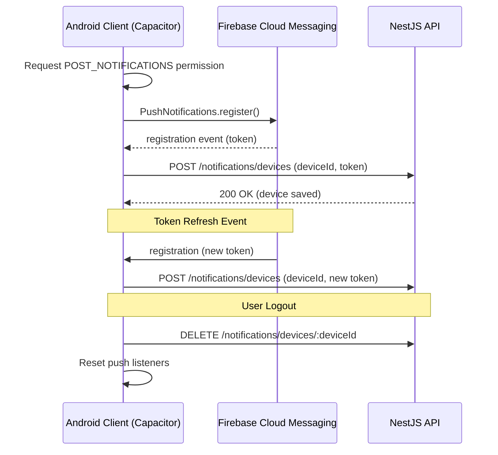

# Firebase Push Notification Architecture & Contracts

**Document:** `docs/android/PUSH_NOTIFICATION_ARCHITECTURE.md`  
**Target:** Melktoday Android Application & NestJS Backend

---

## 1. Overview & Requirements

Push notifications notify users of property updates, listing moderation decisions, chat messages, ticket replies, and promotional broadcasts.

### Key Architectural Constraints:
1. Push delivery is powered by **Firebase Cloud Messaging (FCM)**.
2. The client runtime uses `@capacitor/push-notifications` with Android 13+ `POST_NOTIFICATIONS` runtime permission handling.
3. Stable Installation ID vs. FCM Token:
   - The device installation ID is generated once and persisted in local secure storage.
   - The FCM token is synchronized to the backend on initial registration and refreshed when FCM rotates it.
   - Token must never be used as the permanent primary key of the device.
4. Notifications must link only to verified internal application routes.

---

## 2. Device Registration API Contract (Backend Specification)

Because the current backend exposes notification listing and broadcast endpoints but does not yet have a device registration table, the following contract is specified for the backend team:

### `POST /backend/api/notifications/devices`
**Authentication:** Required (`Bearer <access_token>`)

#### Request Payload:
```json
{
  "deviceId": "a4f89b21-43e2-498c-8f20-b0e5170d41ea",
  "token": "eX_91ab...fcm_token_string...",
  "platform": "ANDROID",
  "appVersion": "1.0.0",
  "osVersion": "14",
  "deviceModel": "Pixel 8 Pro",
  "language": "fa"
}
```

#### Response (`200 OK` or `201 Created`):
```json
{
  "success": true,
  "data": {
    "deviceId": "a4f89b21-43e2-498c-8f20-b0e5170d41ea",
    "status": "ACTIVE",
    "updatedAt": "2026-11-17T08:30:00.000Z"
  }
}
```

### `DELETE /backend/api/notifications/devices/:deviceId`
Invoked upon user logout or app unregistration to disassociate the push token from the authenticated user account.

---

## 3. Notification Payload Contract

Incoming push notifications follow this standard structure:

```json
{
  "notification": {
    "title": "آگهی شما تایید شد",
    "body": "آگهی 'آپارتمان ۱۴۰ متری در هاشمیه' تایید و منتشر گردید."
  },
  "data": {
    "type": "LISTING_APPROVED",
    "referenceId": "ad-12345",
    "targetUrl": "/ads/ad-12345",
    "channelId": "melktoday_listings"
  }
}
```

### URL Validation Rule:
When tapping a notification, the app parses `data.targetUrl`. Only internal relative paths matching the regex `^\/[a-zA-Z0-9_\-\/\?=&]+$` are permitted. Any external or non-whitelisted URL is rejected to prevent deep-link hijacking.

---

## 4. Android Notification Channels

Configured at native startup:

1. **`melktoday_general` (عمومی و اطلاع‌رسانی)**
   - Importance: `HIGH` (Sound & Heads-up banner)
   - For listing approval/rejection, account updates, admin broadcasts.
2. **`melktoday_chat` (پیام‌های گفتگو)**
   - Importance: `HIGH` (Sound, Heads-up banner, Vibration)
   - For real-time direct chat messages between tenants, owners, and agents.

---

## 5. Token Lifecycle & State Handling



---

## 6. Implementation Status

- **Capacitor Push Notifications Plugin:** Integrated and configured.
- **Client Notification Service & Token Manager:** Implemented under `src/platform/push/`.
- **Android Channels & Manifest:** Configured in `AndroidManifest.xml`.
- **Live Push Delivery:** `BLOCKED` until:
  1. Backend team implements `POST /notifications/devices`.
  2. Project Owner provides production `google-services.json`.
